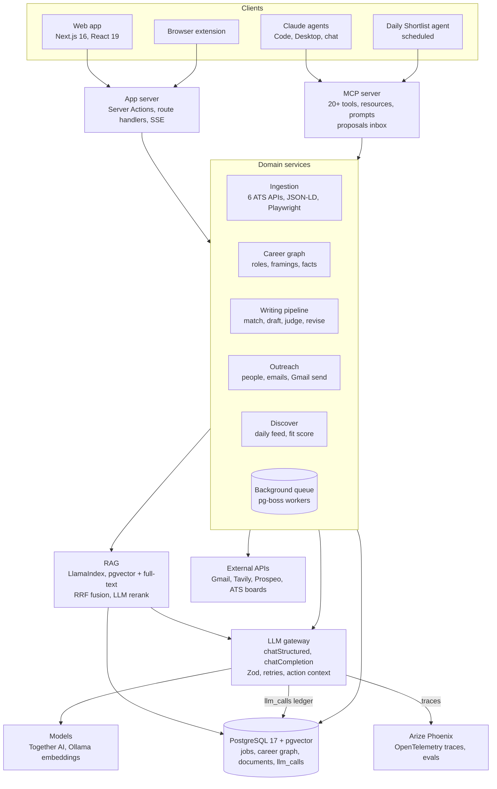

# JobSearch OS

An AI-native job search platform: paste a job link, get a tailored resume, cover letter and cold email in about 5
minutes, then track the application from Saved to Offer. One record per opportunity, AI doing the writing and research,
a human approving every send.

---

## Resume entry

**JobSearch OS: AI-native job search platform** | Next.js 16, React 19, TypeScript, PostgreSQL + pgvector, Drizzle,
LlamaIndex, MCP, OpenTelemetry, Arize Phoenix, Together AI, Playwright, pg-boss, Docker, AWS

- Built a full-stack, agentic job search platform that turns a pasted job link into a tailored, ATS-ready resume, cover
  letter and cold email in under 5 minutes, then tracks the application across 11 pipeline stages.
- Designed a multi-stage LLM pipeline (match, draft, hiring-manager review on 11 criteria, revise) across 7 open-weight
  models with routing by task, Zod-validated structured outputs, thinking-budget fallbacks and code-level faithfulness
  checks that pin every bullet to the source facts it came from.
- Built a hybrid RAG layer (pgvector + Postgres full-text + LLM rerank, orchestrated with LlamaIndex) over a deduplicated
  career knowledge graph merged from resumes, cover letters and LinkedIn, with framing-aware retrieval (engineering vs
  product wording of the same role).
- Shipped a Model Context Protocol (MCP) server with 20+ tools, resources and prompts (Streamable HTTP + stdio) so Claude,
  Claude Code and other agents can read the pipeline, save jobs, research companies and draft outreach, with write
  actions routed through a human-approval proposals inbox.
- Built a resilient ingestion engine for 6 ATS APIs (Greenhouse, Lever, Ashby, Workday, SmartRecruiters, Workable),
  JSON-LD and headless Playwright, with SSRF guards, dedup, a background queue and a 30-page regression fixture suite
  reaching about 90% extraction accuracy.
- Instrumented 100% of model calls with OpenTelemetry/OpenInference traces in Arize Phoenix and a per-call cost ledger in
  Postgres (30+ steps, tokens, latency, spend), plus offline eval harnesses for extraction and resume quality; 1,100+
  Vitest tests across 44k lines of TypeScript.

One line: *Agentic job search platform: RAG over a career knowledge graph, multi-model LLM writing pipeline with
LLM-as-judge review, MCP server for AI agents, full LLM observability (Phoenix + OpenTelemetry).*

---

## Overview

**The problem.** A serious search means 100+ applications, each needing a tailored resume, a cover letter, a contact and
a follow-up. Spreadsheets, scattered resume files and generic AI chat tools lose context, invent experience and cannot
act.

**End to end:**

1. **Capture.** Paste a link, or send one from Claude, a browser extension or a phone. The job is fetched, structured
   into 20+ fields and 25 to 60 weighted keywords, deduplicated and saved.
2. **Understand.** The company is researched once (own site first, then web search) and shared across all its jobs. The
   job gets an explainable fit score with gaps and hard flags (visa, salary, location).
3. **Write.** A resume, cover letter and cold email are written from the career knowledge graph, reviewed by a second
   model acting as a hiring manager, and opened in an A4 editor with live one-page fitting.
4. **Reach out.** The right person is found (hiring manager over recruiter), their email verified, and the cold email sent
   from the user's own Gmail with the right resume attached.
5. **Close the loop.** Replies are detected from Gmail and move the job's status; follow-ups are scheduled; analytics
   show which roles and messages get responses.
6. **Discover.** A daily feed pulls fresh openings from Fortune 500 and Y Combinator companies, ranked by fit.

**Design principles:** the AI proposes and the user decides; user edits are never overwritten; documents used in an
application are locked and versioned forever; cheapest reliable source first (public APIs before scraping, free lookups
before paid); private by default, with every model call observable.

---

## Architecture

Every feature reaches a model only through the LLM gateway, which logs a cost row in Postgres and a full trace in
Phoenix for every call. Slow work (fetching, extraction, career-graph merges, resume generation, contact search) runs on
the background queue, survives restarts and is cancellable end to end.

---

## Core features

### Job ingestion

- **Fetch ladder, cheapest first:** detect the ATS from the URL and call its public JSON API (Greenhouse, Lever, Ashby,
  Workday, SmartRecruiters, Workable); else schema.org `JobPosting` JSON-LD; else HTML, then headless Playwright for
  JS-rendered pages, then Mozilla Readability. YC Work at a Startup pages are read from the data behind the page (tech
  stack, founders, application questions).
- **Structured extraction** into 20+ fields: salary range, remote type, requirements, responsibilities, benefits,
  interview process, and how-to-apply instructions ("use this Google Form, not LinkedIn", subject lines, deadlines)
  classified by type.
- **Background queue:** bulk paste, 2 concurrent workers, survives tab closes and restarts; confident extractions
  auto-save, doubtful ones wait for review.
- **SSRF guard** on every fetch, redirect and Playwright sub-request; dedup by canonical URL and a normalized
  company + title + location hash; immutable raw snapshots for refetch with undo.

### Career knowledge graph

- One merged record of every employer, role, fact and wording across all resumes, cover letters, the profile and a
  LinkedIn export, versioned with full restore.
- **Framings:** the same role told as Product Manager in one resume and Engineer in another is one role with two
  framings; facts are shared, each with per-framing wordings.
- **Merge, never rewrite:** the LLM only classifies (new, same fact reworded, already present); it cannot author text, so
  every wording is verbatim from a source document. Conflicting numbers across documents are surfaced for the user to
  pick once.
- Cover-letter paragraphs are classified into stories, company-specific reasons and filler; a free word-diff preview
  shows what each new document would add before any model call.

### Document generation

- **Requirement matching:** every must-have, nice-to-have, keyword and company value is matched against the graph (In
  record, Partly, Not in record), typed (experience, skill, field, way of working, condition), and 3 to 5 are marked
  Core.
- **Writer, judge, reviser:** GLM-5.3 drafts from the user's own wording; DeepSeek V4.1 Flash reviews like a hiring
  manager on 11 criteria; the writer revises. Code then checks for keyword stuffing (a term in more than 3 places, copied
  JD phrasing), invented results, unsupported summary claims and joined bullets, and reverts any bullet rewritten past
  recognition.
- **Bullet allocation by evidence:** about 14 bullets distributed by how much each role proves for this job; each recent
  role opens with a Core requirement; results lead.
- **Fix with AI:** a weighted keyword and gap panel with a live match score; one click works a gap into the right bullet
  and re-scores.
- Cover letter from career stories and company reasons; cold email (80 to 150 words) drafted straight into the outreach
  composer; follow-ups on the same Gmail thread.

### Editor and export

- Tiptap/ProseMirror A4 editor with slash menu, drag handles, outline, autosave with cross-tab conflict detection, and a
  Keep to one page mode that tightens spacing live.
- A Record panel inserts career-graph wording for the role under the cursor, filtered to the page's framing.
- Pixel-identical PDF (Playwright), DOCX, Markdown and text export; every export is a saved version, and documents lock
  when an application is sent.

### Outreach

- People search across the posting, YC page, web search (Tavily) and Prospeo in parallel, merged and ranked (hiring
  manager, founder, team lead, technical recruiter) with a reason for each.
- Email finding with a cost ladder (saved contacts, public pages, paid lookup, pattern guesses) and verification states.
- Gmail OAuth send with HTML + plain-text parts, up to 10 attachments, hard blocks (Do not contact, unfilled
  placeholders, daily limit) and soft warnings; sent mail is locked in the library.

### Tracking, discovery and analytics

- TanStack Table tracker with 11 statuses, bulk optimistic updates with undo, keyboard navigation and a per-job
  timeline; dashboard with funnel and stale-application alerts.
- **Discover:** a daily feed from Fortune 500 (Workday) and YC (Ashby, Greenhouse, Lever) boards, filtered by
  preferences and ranked by fit score; one click into the tracker.
- **Fit score:** skills, experience, seniority, location and preference fit, with strengths, gaps and hard flags.
- **Gmail reply detection** updates statuses; **analytics** on response, interview and offer rates by role, source and
  score.
- **Interview prep pack** per job from the locked resume, company values and a story bank; offer comparison.

---

## AI and retrieval layer

Every model call goes through one gateway (`chatStructured` / `chatCompletion`) that enforces a step name, a user-action
context, Zod-validated output, abort signals, retries with reduced thinking budgets, and logging to both Postgres and
Phoenix. Model choice is config, not code.

### Model routing

| Task | Model | Why |
| --- | --- | --- |
| Resume, cover letter, cold email drafting and revision | GLM-5.3 (high reasoning effort), MiniMax M3 | Long context, strongest writing per dollar |
| Hiring-manager review (LLM-as-judge, 11 criteria) | DeepSeek V4.1 Flash | A different model family from the writer, so it does not grade its own style |
| Extraction, classification, contact ranking, requirement matching | GLM-5.3 Flash, Qwen3.8 Flash | Cheap, fast, reliable structured output |
| Challenger models in the eval bakeoff | Kimi K3, GPT-OSS 120B | Swapped in by config when an eval wins |
| Embeddings | Qwen3-Embedding 4B (local, Ollama) | Private, free vectors in pgvector |

### Retrieval (RAG)

- **Index:** career-graph facts, wordings, cover-letter stories and past job descriptions are chunked by section and
  stored with `tsvector` and pgvector embeddings, built and refreshed by a LlamaIndex ingestion pipeline on the
  background queue.
- **Query:** the job's keywords are expanded by an LLM ("n8n" also finds "workflow automation", "Zapier"), then hybrid
  search (full-text + vector similarity, fused with Reciprocal Rank Fusion) returns candidates, which an LLM reranks per
  requirement.
- **Framing-aware filters:** retrieval is filtered by role framing (engineering vs product) and recency, so an
  engineering job gets engineering wordings.
- **Grounded generation:** retrieved facts are passed with ids; each output bullet stores the fact ids it came from,
  which powers the faithfulness check and a "References used" panel.

### Agents and MCP

- **MCP server** (`@modelcontextprotocol/sdk`, Streamable HTTP for claude.ai connectors, stdio for Claude Code and Claude
  Desktop) exposes typed tools: `save_job`, `list_jobs`, `get_job`, `change_status`, `add_job_urls`, `queue_status`,
  `research_company`, `search_career_record`, `generate_resume`, `find_contacts`, `draft_cold_email`, `dashboard`;
  resources such as `jobsearchos://job/{id}` and `jobsearchos://profile/latest`; and prompts such as
  `tailor_resume(jobId)`, `interview_prep(jobId)` and `weekly_review`.
- **Proposals inbox:** agent-initiated writes (status changes, notes, drafts) land as proposals the user approves in the
  app; destructive tools are never exposed, which contains prompt injection from untrusted postings and emails.
- **Daily Job Shortlist agent:** a scheduled Claude agent scans new postings each morning, scores fit and sends the good
  ones into the pipeline through `save_job` (idempotent by URL).
- **Agentic workflows over MCP + connectors:** Gmail inbox reconciler (reply detected, status moved), warm-path finder,
  calendar follow-ups, self-healing fetch recipes for new career sites, and a source scout that finds new ATS boards.
- **Research agents** for companies and contacts plan their own queries (own domain first, at most one follow-up search),
  label sources as company-owned or third-party, and keep a full query log.

---

## LLM observability, evals and cost

Every model call is logged twice by construction: numbers in Postgres, full text in Phoenix. There is no code path to a
model that skips either.

- **Cost ledger (`llm_calls`):** one row per call with step, user action, model, input, output and reasoning tokens,
  cost, latency, outcome (ok, failed, stopped) and the job, company or document it served. Prompts and replies are never
  stored in the app database.
- **Tracing:** OpenTelemetry with OpenInference instrumentation exports one trace per user action to Arize Phoenix, so a
  resume generation shows match, draft, review and revise as child spans with full prompts.
- **Context propagation:** `AsyncLocalStorage`-based `withLlmContext(action, ids, fn)` ties every nested call to what
  the user clicked.
- **AI usage dashboard:** spend per day, cost per action, breakdown by step and model, failures with HTTP status and
  request id, and a deep link from any call into its Phoenix trace.
- **Evals:** offline harnesses (`eval:jobs`, `eval:resume`, `eval:writer`) run against recorded job snapshots;
  extraction is scored field by field against fixtures, resumes by the 11-criterion judge plus code checks for
  faithfulness and stuffing. Phoenix datasets and experiments compare prompts and models before a switch.
- **Guardrails in code, not prompts:** truncation, non-JSON output and schema mismatch raise typed errors; stuck calls
  are cut off and retried once with a smaller thinking budget; user-stopped jobs are never retried.

---

## Tech stack

| Layer | Technologies |
| --- | --- |
| Frontend | Next.js 16 (App Router, React Server Components, Server Actions), React 19 + React Compiler, TypeScript, Tailwind CSS v4, shadcn/ui on Base UI, TanStack Table, TanStack Query, nuqs, React Hook Form, cmdk, Sonner, lucide-react |
| Editor | Tiptap 3 / ProseMirror, custom A4 layout engine with one-page fitting |
| Charts | Apache ECharts |
| Backend | Next.js route handlers and Server Actions, Node.js 20, Zod 4 at every boundary, Server-Sent Events for live progress |
| Data | PostgreSQL 17, pgvector, full-text search (`tsvector`), Drizzle ORM and migrations, content-addressed file storage (SHA-256), S3 in production |
| Jobs and queues | pg-boss (Postgres-backed queue), restart recovery, cancellation through AbortSignal |
| LLM | Together AI (OpenAI-compatible): GLM-5.3, MiniMax M3, DeepSeek V4.1, Qwen3.8, Kimi K3, GPT-OSS 120B; Claude via MCP; Ollama for local embeddings |
| RAG | LlamaIndex (ingestion and retrieval), pgvector, hybrid search with Reciprocal Rank Fusion, LLM reranking, query expansion |
| Agents | Model Context Protocol SDK (Streamable HTTP + stdio), Claude scheduled agents, Gmail and Google Calendar connectors |
| Observability | OpenTelemetry, OpenInference, Arize Phoenix (traces, datasets, experiments), Postgres cost ledger |
| Scraping | Playwright (Chromium), Mozilla Readability, jsdom, JSON-LD parsing, ATS APIs |
| Documents | unpdf and mammoth (PDF and DOCX parsing), docx (Word export), Playwright PDF rendering |
| Integrations | Gmail API (OAuth 2.0), Tavily web search, Prospeo contact and email lookup |
| Testing | Vitest (1,100+ tests, 75 suites), recorded fixtures, Playwright end-to-end, eval harnesses |
| Infrastructure | Docker and Docker Compose, GitHub Actions CI, AWS (ECS Fargate, RDS for PostgreSQL, S3), Cloudflare Tunnel, Auth.js sign-in |

---

## Engineering quality

- **Scale:** about 44,000 lines of TypeScript, 1,100+ tests in 75 Vitest suites, 28 versioned Drizzle migrations, 30+
  named LLM steps across 14 user actions.
- **Testing:** unit and integration tests run against a separate Postgres database; model calls are mocked at the
  client so tests never reach a real model; recorded job pages and API responses act as regression fixtures; Playwright
  end-to-end tests drive the real UI.
- **Data integrity:** immutable job snapshots, profile versions and document versions; documents lock on Applied or on
  send (app code and a database trigger); every career-graph merge is a restorable version.
- **Security:** SSRF guard on every outbound fetch including redirects and headless-browser sub-requests; MCP endpoint
  behind a secret path and OAuth, exposing only non-destructive tools; least-privilege Gmail scopes; no prompt or reply
  text in the app database.
- **Reliability:** background work survives page changes, tab closes and server restarts; every long task is
  cancellable end to end through AbortSignal down to the HTTP call; failures carry structured details (step, HTTP
  status, request id) shown in the UI.
- **Performance:** server components read directly from Postgres with no client waterfalls; the editor and charts load
  lazily; tables paginate or virtualize; optimistic updates with rollback.
- **Standards:** strict TypeScript, ESLint with custom rules, a single LLM gateway, CI on every push (lint, typecheck,
  tests, build).
- **Deployment:** containerized with Docker; runs locally with Docker Compose or on AWS (ECS Fargate, RDS, S3) behind
  sign-in, with Phoenix as a sidecar collector.
